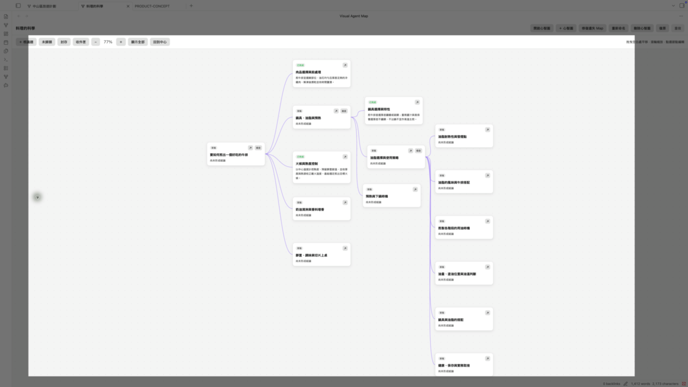

# Visual Agent Map

**English** · [繁體中文](README.zh-TW.md)

### Explore big questions with visual AI research in Obsidian

**Start with a question. See the pieces. Follow the ideas worth exploring.** Build a visual research map, let AIM investigate a question, or talk through a new idea in Coffee Tables. Everything you keep is editable Markdown in your vault.

[**Get started**](#get-started) · [See the 0.26.0 release](https://github.com/kevcltsai/visual-agent-map/releases/tag/0.26.0) · [Installation guide](INSTALL.md)

## Three ways to explore

- **Visual maps.** Break a question into topics and research any branch with AI. Draft a multi-level outline, review suggestions before adding them, pick a note style such as Textbook, merge related topics, and research several topics in the background. Manual mapping needs no AI.
- **AIM — Adaptive Inquiry Map.** Give it your question and background, answer the opening questions once, and let it run. Watch each subtopic on the map and finish with a document backed by sources.
- **Coffee Tables.** Bring an unfinished idea to a conversation with simulated AI guests, then revisit the observer's insights.

When a map is ready, save it as one HTML file you can open in any browser, even offline (images that link to the web need a connection), or send to someone else, optionally with AI-translated versions.

## Get started

1. In **Obsidian Desktop → Settings → Community plugins → Browse**, find **Visual Agent Map**, then install and enable it. Requires Obsidian **1.13.7+** on desktop.
2. Open the built-in sample or create a map. For AI features, install and sign in to [Codex CLI](https://developers.openai.com/codex/cli/) or [Claude Code](https://docs.anthropic.com/en/docs/claude-code/overview), then check the CLI in VAM settings.
3. Choose **＋ New map → New AIM** to try AIM.

The interface is available in English, Traditional Chinese and Simplified Chinese. AI answers follow the language you write in, including Japanese, Korean, Spanish and other languages.

Setup details, troubleshooting, and known limitations are in [INSTALL.md](INSTALL.md).

## Contributing checks

- `npm run verify` runs the same checks as CI (lint, format, tests, committed artifacts).
- Run `git config core.hooksPath .githooks` so it runs automatically before every push.
- Never bypass it with `--no-verify`.

## Privacy

VAM has no telemetry and does not store API keys. AI tasks send relevant content through your local CLI to OpenAI or Anthropic, so your provider allowance or charges may apply. VAM runs the Codex or Claude Code program you installed; when you use AIM or AI research, that program searches the web for you. A share file is saved in your vault or the place you choose, and VAM never uploads it; whether to publish it is up to you. Images in a share file that link to the web are loaded by the reader's browser from the original site.

## Credits and license

AIM's research approach is inspired by [MindSearch](https://github.com/InternLM/MindSearch) and [Chen et al. (2024)](https://arxiv.org/abs/2407.20183). VAM implements it independently; this does not imply affiliation or endorsement. The code is licensed under Apache-2.0; the Visual Agent Map name and logo are not, so forks need their own name (see [NOTICE](NOTICE)).

[Report an issue](https://github.com/kevcltsai/visual-agent-map/issues) · [Changelog](CHANGELOG.md) · [Apache-2.0](LICENSE)

Copyright © 2026 Kevin Tsai
