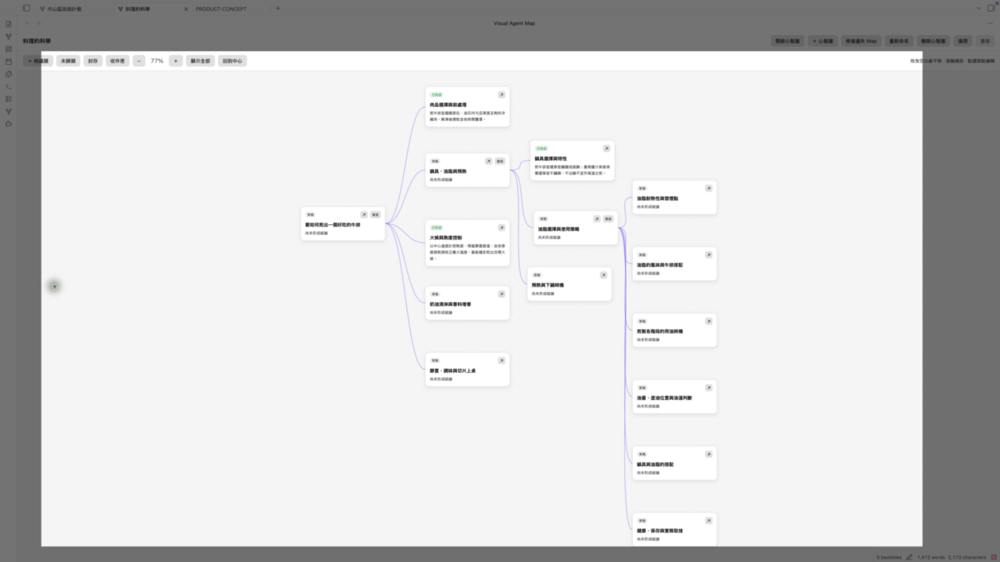
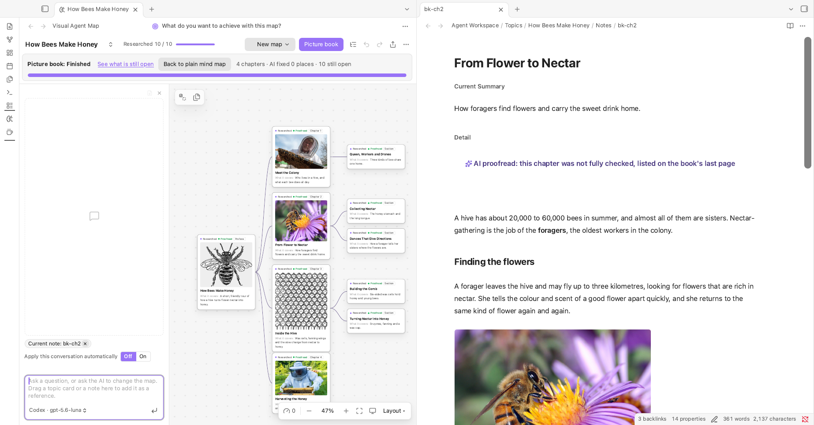
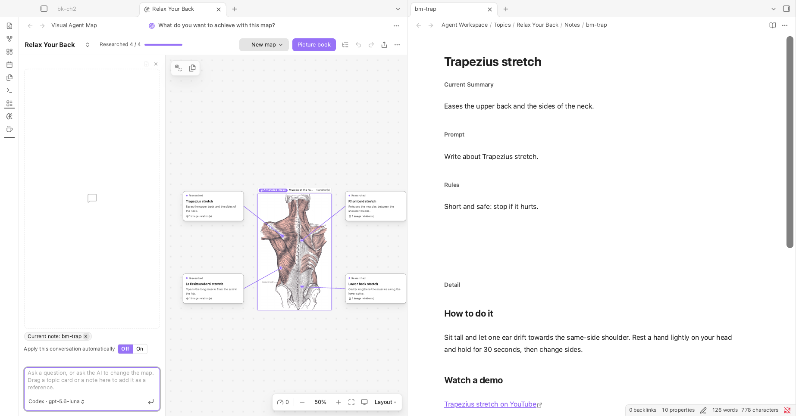

# Visual Agent Map

**English** · [繁體中文](README.zh-TW.md)

### Research a question, write a picture book, or explore from one picture in Obsidian

Start with a question, a topic or a picture. VAM's AI lays it out as a visual map, researches it with you, and keeps everything as editable Markdown in your vault.

[**Get started**](#get-started) · [See the 0.35.1 release](https://github.com/kevcltsai/visual-agent-map/releases/tag/0.35.1) · [Installation guide](INSTALL.md)

## Mind map: from one question to topics

Type one question and VAM splits it into topics on a map. Research any branch (Quick answers from the model's own knowledge, Standard searches the web), expand it further, or just tell the map chat what to change. You can also build a map by hand with no AI.

## Picture book: from one topic to a whole book

Name a topic and collect pictures for it: a chief editor plans the preface, chapters and sections, and you confirm the plan before anything is written. An author then writes each chapter with pictures and diagrams, and a different AI model proofreads it, so the book reads from start to finish instead of as loose notes. You can stop at any step, or give up the book and keep the map.

## Start from one picture

Put one picture at the centre and pin anchors on its parts. Ask for "back stretches", for example: VAM finds a picture of the back muscles, puts an anchor on each sore muscle, and links each one to a topic with matching stretch pictures and videos.

Also: save any map as one HTML file that opens in any browser, and talk an unfinished idea through with AI guests in Coffee Tables.

## Get started

1. In **Obsidian Desktop → Settings → Community plugins → Browse**, find **Visual Agent Map**, then install and enable it. Requires Obsidian **1.13.7+** on desktop.
2. For AI features, install and sign in to [Codex CLI](https://developers.openai.com/codex/cli/) or [Claude Code](https://docs.anthropic.com/en/docs/claude-code/overview), then check the CLI in VAM settings.

The interface is in English, Traditional Chinese and Simplified Chinese; AI answers follow the language you write in. Setup details, troubleshooting and known limitations are in [INSTALL.md](INSTALL.md).

## Privacy

VAM has no telemetry and stores no API keys. AI features run the Codex or Claude Code program you installed, which sends the relevant notes, map content and selected pictures to OpenAI or Anthropic (your plan's allowance or charges apply) and searches the web in Standard mode and picture search. Picture books may also search Wikimedia Commons directly, and research checks YouTube videos with YouTube's oEmbed service. Share files are never uploaded. Full details: [Data and permissions](INSTALL.md#data-and-permissions).

## Credits and license

The code is licensed under Apache-2.0; the Visual Agent Map name and logo are not, so forks need their own name (see [NOTICE](NOTICE)).

[Report an issue](https://github.com/kevcltsai/visual-agent-map/issues) · [Changelog](CHANGELOG.md) · [Apache-2.0](LICENSE)

Copyright © 2026 Kevin Tsai
