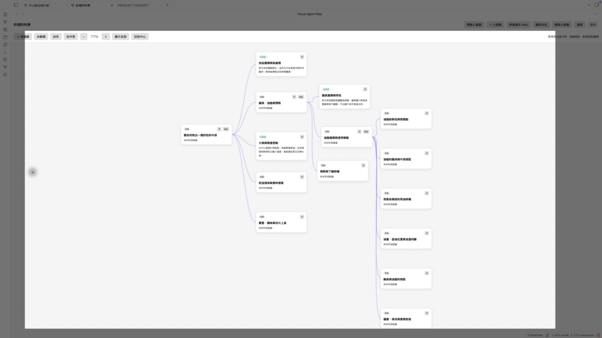
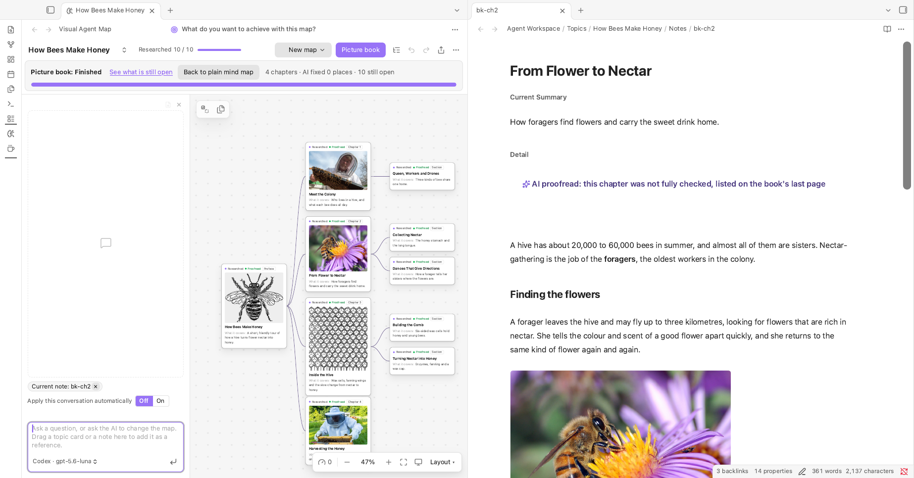
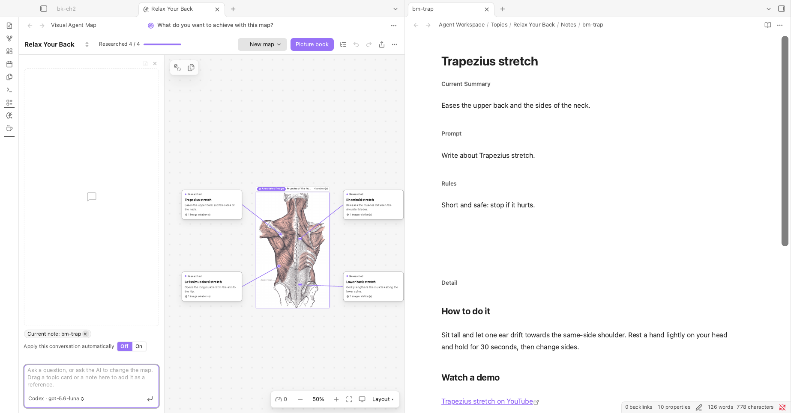

# Visual Agent Map

[English](README.md) · **繁體中文**

### 在 Obsidian 研究一個問題、做一本圖文書，或從一張圖片展開

從一個問題、一個議題或一張圖片開始。VAM 的 AI 把它排成視覺化地圖、陪你研究，所有內容都是 Vault 裡可編輯的 Markdown。

[**開始使用**](#開始使用) · [查看 0.35.1 正式版](https://github.com/kevcltsai/visual-agent-map/releases/tag/0.35.1) · [安裝指南](INSTALL.md)

## 心智圖：從一個問題拆成議題

輸入一個問題，VAM 會把它拆成地圖上的議題。任何分支都能研究（快速只用模型自身的知識，標準會上網搜尋）、再往下展開，或直接告訴地圖對話要改什麼。不用 AI 也能手動畫地圖。

## 圖文書：從一個議題做成一本書

說出一個議題並收集圖片：總編輯先規劃序、各章與各節，你確認企劃後才開始寫。接著作者逐章寫出圖文並茂的內容、配上圖表，再由另一個 AI 模型校對，讓整本書能從頭讀到尾，而不是零散的筆記。任何階段都能停下，也能放棄這本書、保留地圖。

## 從一張圖片展開

把一張圖片放在中心，在各部位釘上錨點。例如說「背部伸展」：VAM 會找一張背部肌肉圖，在每塊酸痛的肌肉上放錨點，再各自連到有伸展圖片與影片的議題。

還有：任何地圖都能存成一個 HTML 檔，用任何瀏覽器開啟。

## 開始使用

1. 到 **Obsidian 桌面版 → 設定 → 第三方外掛 → 瀏覽** 搜尋 **Visual Agent Map**，安裝並啟用。需要桌面版 Obsidian **1.13.7+**。
2. 使用 AI 功能前，安裝並登入 [Codex CLI](https://developers.openai.com/codex/cli/) 或 [Claude Code](https://docs.anthropic.com/en/docs/claude-code/overview)，再到 VAM 設定檢查 CLI。

介面提供英文、繁體中文與簡體中文；AI 回答會跟著你書寫的語言。詳細設定、問題排除與已知限制，請見 [INSTALL.md](INSTALL.md)。

## 隱私

VAM 不含遙測，也不儲存 API key。AI 功能會在你的電腦上另外啟動你安裝的 Codex 或 Claude Code 程式，把相關筆記、地圖內容與你選的圖片傳送至 OpenAI 或 Anthropic（可能使用帳號額度或產生費用），並在標準模式與找圖時上網搜尋。圖文書也可能直接向 Wikimedia Commons 搜尋圖片，研究也會向 YouTube 的 oEmbed 服務確認影片。地圖的資料來源也可以是你加入的 vault 外資料夾：VAM 只讀取它，這些資料夾的清單存在本機 vault 外的一個檔案。分享檔不會被上傳。完整說明：[資料與權限](INSTALL.md#資料與權限)。

## 致謝與授權

程式碼採用 Apache-2.0 授權，但 Visual Agent Map 的名稱與標誌不在授權範圍內，fork 請使用自己的名稱（見 [NOTICE](NOTICE)）。

[回報問題](https://github.com/kevcltsai/visual-agent-map/issues) · [版本紀錄](CHANGELOG.md) · [Apache-2.0](LICENSE)

Copyright © 2026 Kevin Tsai
