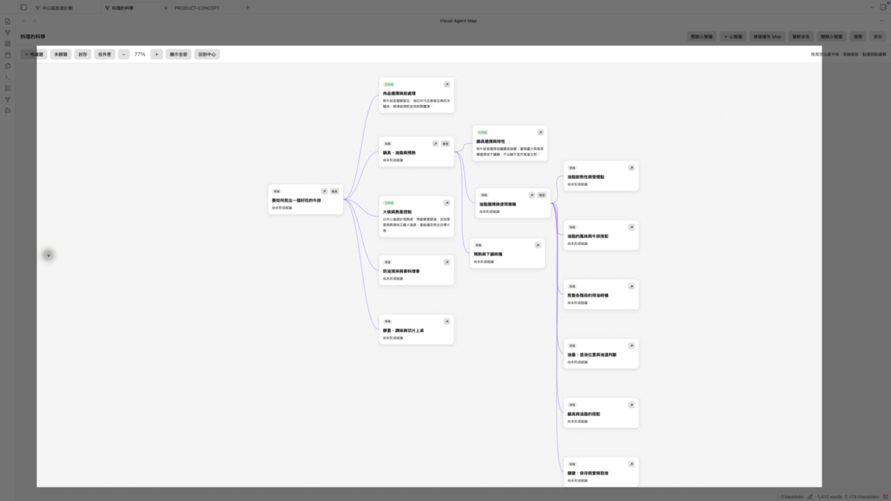

# Visual Agent Map

[English](README.md) · **繁體中文**

### 在 Obsidian，用視覺化 AI 地圖探索問題

**從一個問題出發，看見各個部分，再追你想探索的線索。** 建立視覺化研究地圖，或到 Coffee Tables 聊出新角度。想留下的內容都是 Vault 裡可編輯的 Markdown。

[**開始使用**](#開始使用) · [查看 0.32.0 正式版](https://github.com/kevcltsai/visual-agent-map/releases/tag/0.32.0) · [安裝指南](INSTALL.md)

## 兩種探索方式

- **視覺化地圖。** 把問題拆成議題，用 AI 深入任何一個分支。可以草擬多層大綱、先看過建議再決定是否加入，可以為每種議題類型選擇筆記風格（段落結構、寫作口吻、格式規則與更新方式，例如教科書，一般議題也可選「AI 建議」；也能用 Markdown 自己寫）、合併相關議題，也能在背景同時研究多個議題、為地圖指定自己的資料來源，並在圖片上放錨點連到議題。手動繪圖不需要 AI。
  - **對地圖說話。** 在地圖旁開啟 AI 對話，用一般的話說出需求：一句話建出整張地圖、新增／移動／改名議題、研究或展開某個分支、找圖、在選取的標註圖上放錨點，或修改你指定的筆記。大量變更會先列成計畫，每個動作都有結果列。
  - **快速或標準。** 快速只用模型自身的知識、不上網；標準會上網搜尋，並可配圖。每次研究或展開時選擇。
- **Coffee Tables。** 把未成形的想法帶來，與模擬的 AI 來賓對談，再回看觀察者整理的洞見。

地圖完成後，可以存成一個 HTML 檔，在任何瀏覽器開啟（也能離線；連到網路的圖片需要連線才顯示），或傳給別人，還能加上 AI 翻譯版本。

## 開始使用

1. 到 **Obsidian 桌面版 → 設定 → 第三方外掛 → 瀏覽** 搜尋 **Visual Agent Map**，安裝並啟用。需要桌面版 Obsidian **1.13.7+**。
2. 首次使用時 VAM 會開啟一張空白心智圖：用一句話開始，或直接加議題。使用 AI 功能前，安裝並登入 [Codex CLI](https://developers.openai.com/codex/cli/) 或 [Claude Code](https://docs.anthropic.com/en/docs/claude-code/overview)，再到 VAM 設定檢查 CLI。

介面提供英文、繁體中文與簡體中文。AI 回答會跟著你書寫的語言，包括日文、韓文、西班牙文等其他語言。

詳細設定、問題排除與已知限制，請見 [INSTALL.md](INSTALL.md)。

## 貢獻檢查

- `npm run verify` 與 CI 執行同一組檢查（lint、格式、測試、已提交產物）。
- 執行 `git config core.hooksPath .githooks`，每次 push 前會自動跑。
- 不要用 `--no-verify` 跳過。

## 隱私

VAM 不含遙測，也不儲存 API key。AI 任務會透過本機 CLI 將相關內容傳送至 OpenAI 或 Anthropic，可能使用帳號額度或產生費用。地圖 AI 對話會送出地圖大綱、你其他地圖的標題、你選取或加入參考的議題、你選取的標註圖（圖片本身）、地圖旁開著的筆記（整篇，以可移除的標籤顯示）、你拖入的筆記或文字，以及最近幾則訊息；它可以修改這些筆記，也能在 vault 中新增筆記。研究、展開與收斂也會讀取地圖資料來源裡的項目。保存地圖 AI 對話預設關閉；開啟後對話會存在你的 vault。VAM 會執行你安裝的 Codex 或 Claude Code 程式；使用標準研究或找圖時，該程式會代你上網搜尋（快速模式不會）。找圖候選的縮圖會直接從各網站載入。分享檔會存在你的 vault 或你選的位置，VAM 不會上傳；要不要發佈由你決定。分享檔裡連到網路的圖片，會由讀者的瀏覽器向原網站載入。

## 致謝與授權

程式碼採用 Apache-2.0 授權，但 Visual Agent Map 的名稱與標誌不在授權範圍內，fork 請使用自己的名稱（見 [NOTICE](NOTICE)）。

[回報問題](https://github.com/kevcltsai/visual-agent-map/issues) · [版本紀錄](CHANGELOG.md) · [Apache-2.0](LICENSE)

Copyright © 2026 Kevin Tsai
