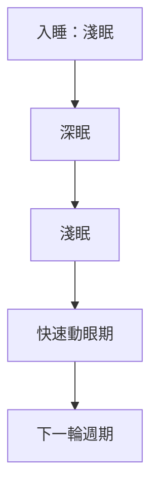

# 睡眠週期與階段

## Current Summary

成人一晚約 4 至 5 輪、每輪約 90 分鐘的睡眠週期，深眠多在前半夜、快速動眼期多在後半夜，固定起床與減少咖啡因能配合此節奏。

> [!vam-book]- 預覽
> 成人一晚約 4 至 5 輪、每輪約 90 分鐘的睡眠週期，深眠多在前半夜、快速動眼期多在後半夜，固定起床與減少咖啡因能配合此節奏。

## Detail

<!-- visual-agent-map:detail:start -->
很多人躺下後翻來覆去，早上醒來卻覺得沒睡飽，或凌晨三、四點突然清醒、再也睡不著。這類困擾很常見，但多數時候問題不在「睡得不夠久」，而是夜裡的睡眠節奏被打亂了。要理解這一點，得先看一晚睡眠內部是怎麼運作的。

上一章提到成人每晚約需 7 至 9 小時睡眠，並列出固定起床時間、睡前關螢幕與午後少咖啡因三個起點。7 至 9 小時是總量，本章要看的則是這段時間如何被切成一段段的週期與階段。

睡眠並不是一路平穩的昏睡。成年人入睡後，會依序經過幾輪「睡眠週期」，每輪約 90 分鐘，一晚常見 4 至 5 輪。在每一輪之中，身體會在淺眠（非快速動眼期的第一、二階段）、深眠（非快速動眼期的第三階段，又稱慢波睡眠）與快速動眼期之間輪替，每一輪大致都是「由淺入深、再進入快速動眼期」的順序。

這是一張健康成人一晚睡眠的階段曲線圖，請注意深眠階段多集中在前半夜，快速動眼期則隨夜晚推進逐漸變長。

一晚的分布有一個大致的傾向。前半夜的週期裡，深眠所佔比例較高，身體的修復與體力恢復多集中在這段時間。到了後半夜，深眠逐漸變少，快速動眼期每輪都拉得較長，清晨前通常是最長的一段。快速動眼期與記憶和情緒整理有關，所以後半夜若被打斷，白天對學過的內容與情緒的調節也會受影響。

> [!summary] 核心重點
> 睡眠是一輪一輪循環的，不是單一狀態。前半夜以深眠為主，後半夜以快速動眼期為主，兩者都需要完整的時間才能發揮作用。

> [!note]- 週期長度的差異
> 每個人的週期長度不同。Sleep Foundation 指出，第一輪常見 70 至 100 分鐘，後面幾輪多在 90 至 120 分鐘之間。另有資料指出成人多為 4 至 6 輪，本章以 4 至 5 輪作為常見範圍。這些數字是平均值，不必用來逐分鐘對照自己的睡眠。

週期的實際意義在於「醒來的時機」。若鬧鐘在深眠中響起，人通常會覺得特別昏沉；若醒來時恰好接近一輪的尾聲、睡眠較淺，起床會比較輕鬆。固定起床時間正是利用這一點：每天在相近的時間醒來，身體會逐漸把入睡與醒來的時間對齊，讓週期的節奏保持規律，生理時鐘也有了穩定的錨點。即使前一晚睡得晚，也盡量維持起床時間不變，因為這個錨點通常比睡覺時間更有影響力。

螢幕光線與咖啡因則影響「能否順利進入下一輪」。螢幕的藍光被認為可能延後褪黑激素的分泌，但研究對影響幅度仍有分歧，因此較穩妥的做法是睡前半小時到一小時減少使用，而不是把它視為唯一原因。咖啡因的半衰期差異很大，Sleep Foundation 指出約介於 2 至 12 小時之間。若以半衰期 5 至 6 小時粗略估算，下午 4 點喝的一杯咖啡，到晚上 10 點仍可能殘留約一半的劑量。這樣的殘留可能讓夜裡的淺眠變得更淺、醒來次數增加，使週期難以完整運作。

> [!warning] 限制
> 若失眠已持續三個月以上，單靠睡眠衛生通常不足，認知行為治療是指引建議的首選方式。以上的調整是生活習慣的起點，不能取代醫療評估。

以下是一個可以立即嘗試的小練習，為期一週。

1. 選定一個每天的起床時間，包括週末，誤差控制在 30 分鐘內，連續 7 天。
2. 下午 2 點之後不再喝咖啡、濃茶或含咖啡因的飲料。
3. 睡前 60 分鐘把螢幕亮度調低，或改為紙本閱讀。
4. 每天早上記錄三件事：入睡時間、醒來時間，以及白天的精神狀態（1 至 10 分）。

> [!question] 檢核問題
> 這一週的起床時間是否大致一致？
> 醒來時是否常覺得特別昏沉，像是在深眠中被叫醒？
> 下午之後的咖啡因是否確實減少？入睡時間與白天精神有沒有變化？

本書到這裡告一段落。回到前章的三個起點，睡眠週期提醒我們，改善不必一次全部做到。請從固定起床時間、睡前減少螢幕光線與咖啡因中挑出一兩項，從今晚開始試一週，再看看入睡的速度與白天的精神有什麼不同。

### 來源

- Sleep Foundation，Stages of Sleep：https://www.sleepfoundation.org/how-sleep-works/stages-of-sleep
- Sleep Foundation，Caffeine and Sleep：https://www.sleepfoundation.org/sleep-hygiene/caffeine-and-sleep
- Simply Psychology，5 Stages of Sleep：https://simplypsychology.org/sleep-stages.html

### 更新紀錄

2026-11-18　已用新研究取代，舊版備份在 Agent Workspace/筆記風格/備份/筆記/sleep-cycle 2026-11-18 172748.md
> [!note]- 研究備註
> &lt;!-- book-slots:v1 {"slots":[{"index":1,"state":"placed","hash":"52aa5436"},{"index":2,"state":"missing","reasonCode":"not_found"}],"bad":0} -->
>

2026-11-18　已用新研究取代，舊版備份在 Agent Workspace/筆記風格/備份/筆記/sleep-cycle 2026-11-18 173750.md

> [!vam-book]- 研究備註
>
> <!-- book-slots:v1 {"slots":[{"index":1,"state":"placed","hash":"58f50db3"}],"bad":0} -->
>
> 校對（需人看；事實項目皆待查） 開頁 2 次、搜尋 1 次
> - C1 達成：開頭提到翻來覆去、凌晨清醒等常見睡眠困擾。
> - C2 達成：內文同時出現睡眠週期、淺眠、深眠與快速動眼期等詞。
> - C3 待查：來源支持每輪約 90 分鐘，但來源寫一晚典型為 4 至 6 輪，與內文的 4 至 5 輪不完全一致。（開頁：`https://www.sleepfoundation.org/stages-of-sleep` `https://www.sleepfoundation.org/sleep-health-basics/stages-of-sleep`）
> - C4 待查：來源支持深眠集中於前半夜、REM 後半夜較長及 REM 與記憶的關聯，但未說明 REM 與情緒整理的關係。（開頁：`https://www.sleepfoundation.org/stages-of-sleep` `https://www.sleepfoundation.org/sleep-health-basics/stages-of-sleep`）
> - C5 達成：內文明確提及上一章的成人每晚 7 至 9 小時需求。
> - C6 達成：內文說明固定起床時間、螢幕光線與咖啡因如何影響週期與入睡。
> - C7 達成：提供為期一週的四個具體步驟與三個檢核問題。
> - C8 達成：結尾請讀者從固定起床、減少螢幕與咖啡因中挑出一兩項開始試行。
> <!-- book-proof:v1 {"key":"7f43fab6-96bc-4b1d-8ac9-5bad7d61e20e:sleep-cycle:5:0c772cdb7c5ac3df:537b496e0867ee44","result":{"aggregate":"needs-review","factsUnverified":true,"items":[{"id":"C1","type":"structure","status":"met","note":"開頭提到翻來覆去、凌晨清醒等常見睡眠困擾。","sources":[]},{"id":"C2","type":"structure","status":"met","note":"內文同時出現睡眠週期、淺眠、深眠與快速動眼期等詞。","sources":[]},{"id":"C3","type":"fact","status":"unverified","note":"來源支持每輪約 90 分鐘，但來源寫一晚典型為 4 至 6 輪，與內文的 4 至 5 輪不完全一致。","sources":["https://www.sleepfoundation.org/stages-of-sleep","https://www.sleepfoundation.org/sleep-health-basics/stages-of-sleep"]},{"id":"C4","type":"fact","status":"unverified","note":"來源支持深眠集中於前半夜、REM 後半夜較長及 REM 與記憶的關聯，但未說明 REM 與情緒整理的關係。","sources":["https://www.sleepfoundation.org/stages-of-sleep","https://www.sleepfoundation.org/sleep-health-basics/stages-of-sleep"]},{"id":"C5","type":"structure","status":"met","note":"內文明確提及上一章的成人每晚 7 至 9 小時需求。","sources":[]},{"id":"C6","type":"structure","status":"met","note":"內文說明固定起床時間、螢幕光線與咖啡因如何影響週期與入睡。","sources":[]},{"id":"C7","type":"structure","status":"met","note":"提供為期一週的四個具體步驟與三個檢核問題。","sources":[]},{"id":"C8","type":"structure","status":"met","note":"結尾請讀者從固定起床、減少螢幕與咖啡因中挑出一兩項開始試行。","sources":[]}],"counts":{"openedPages":2,"searches":1}},"model":"claude:haiku","authorModel":"claude:haiku"} -->
<!-- visual-agent-map:detail:end -->

> [!vam-book]- Prompt
> 角色：本文
> 本章會講：本章說明一晚睡眠約 4 至 5 輪、每輪約 90 分鐘的週期，以及淺眠、深眠與快速動眼期在其中的輪替。前半夜深眠較多，有助身體恢復；後半夜快速動眼期較長，與記憶和情緒整理有關。最後回到固定起床時間、睡前減少螢幕光線與咖啡因，說明這些調整為何能配合睡眠週期。
> 接入點：本章接續前一張卡片的 7 至 9 小時睡眠需求，從一晚睡眠內部的週期與階段切入。
> 留給下一張的問題：本書以結尾段落收束，回到前章的三個起點，請讀者從固定起床時間、睡前減少螢幕光線與咖啡因中挑出一兩項立即執行。
> 前一張：(1) 睡眠：怎麼睡得更好？ — 前一章介紹成人每晚約需 7 至 9 小時睡眠，並列出固定起床時間、睡前關螢幕與午後少咖啡因三個起點，本章以此為基礎說明其原理。
> 後一張：無
> 圖安排：
> - 圖位 1｜示意圖｜以約 90 分鐘為一輪的圖示，呈現淺眠、深眠與快速動眼期在一夜中的輪替。｜位置：說明一晚約 4 至 5 輪、每輪約 90 分鐘週期的段落
> 驗收清單：
> - C1 [結構型] 開頭段落提及至少一種常見的睡眠困擾
> - C2 [結構型] 內文出現「睡眠週期」「淺眠」「深眠」與「快速動眼期」等詞
> - C3 [事實型] 內文敘述一晚約 4 至 5 輪、每輪約 90 分鐘的睡眠週期
> - C4 [事實型] 內文敘述深眠多集中於前半夜、快速動眼期在後半夜較長，且快速動眼期與記憶和情緒整理有關
> - C5 [結構型] 內文提及前一章的成人每晚 7 至 9 小時睡眠需求
> - C6 [結構型] 內文說明固定起床時間、減少螢幕光線與睡前咖啡因如何與睡眠週期相關
> - C7 [結構型] 章節含一段可立即實作的小練習，列出具體步驟與檢核問題
> - C8 [結構型] 結尾段落提出讀者可挑選一兩項立即執行的調整

> [!vam-book]- 校對結果（最新一次）
> - C1 達成
> - C2 達成
> - C3 待查：來源支持每輪約 90 分鐘，但來源寫一晚典型為 4 至 6 輪，與內文的 4 至 5 輪不完全一致。
> - C4 待查：來源支持深眠集中於前半夜、REM 後半夜較長及 REM 與記憶的關聯，但未說明 REM 與情緒整理的關係。
> - C5 達成
> - C6 達成
> - C7 達成
> - C8 達成
> - 圖文：對得上（1 張圖）
> - 作者模型：Claude · Haiku
> - 校對模型：Claude · Haiku
